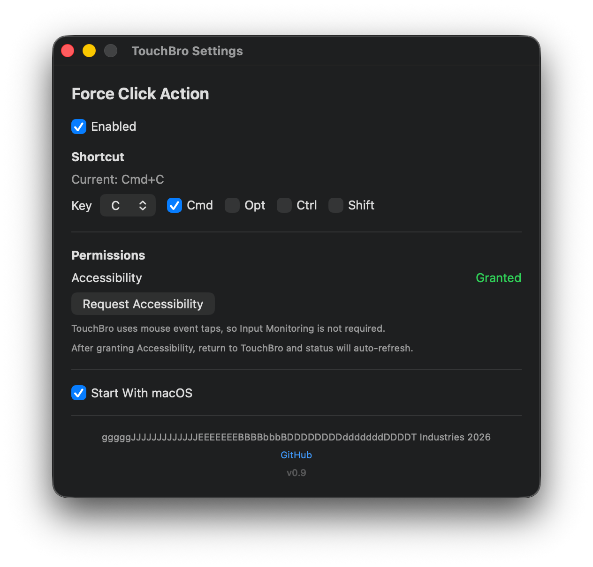

<p align="center">
  
</p>

<h1 align="center">TouchBro</h1>

<p align="center">
  Minimal Apple Silicon native menu bar app that maps a <b>trackpad force click</b> to a configurable keyboard shortcut (default: <code>Cmd+C</code>).
</p>

<p align="center">
  Completely free and open source • Inspired by <a href="https://folivora.ai/">BetterTouchTool</a>
</p>

## Features

- Menu bar app with a single settings window.
- Force-click detection via `MultitouchSupport` Apple's private framework.
- Works with the built-in trackpad and external Magic Trackpads, including ones connected after launch or after the Mac wakes from sleep.
- Configurable shortcut key + modifiers.
- App exceptions: pick apps where force click does nothing (Finder is excluded by default).
- Autostart toggle.
<p align="center">
  
</p>

> [!NOTE]
> **What is `MultitouchSupport`?**
> It is a private macOS framework that gives low-level access to raw trackpad data. The public macOS APIs only report the high-level "Force Click" gesture, which is usually tied to Look Up. TouchBro reads the pressure values from the trackpad sensors instead, so it can fire the shortcut in any app as soon as you press, even where the system gesture is disabled or blocked.

## Install: remove quarantine

If the app was downloaded/copied and macOS flags it as quarantined:

```bash
xattr -dr com.apple.quarantine /path/to/TouchBro.app
```

If installed in `/Applications`:

```bash
xattr -dr com.apple.quarantine /Applications/TouchBro.app
```
## First run

1. Launch the app.
2. Open **Settings** from menu bar.
3. Click **Request Accessibility** and grant access in System Settings.
4. Return to TouchBro.

> [!IMPORTANT]
> **Why Accessibility?**
> macOS only lets "trusted" apps (ones granted Accessibility permission) read the text you have selected in other apps and send keystrokes such as `Cmd+C` on your behalf. TouchBro needs both to turn a force click into the shortcut.
> It never records your keystrokes or sends data anywhere, and it has no internet access.


## App exceptions

You can turn TouchBro off in specific apps, such as games or apps that already use force click for their own features.

1. Open **Settings**.
2. Scroll to the **Exceptions** list.
3. Click **+ Add App** to select an application bundle (Finder is excluded by default).
4. TouchBro ignores force clicks in every app on the list.

## Start With macOS

TouchBro can register itself as a login item so it launches automatically after sign-in.

1. Open **Settings**.
2. Enable **Start With macOS**.
3. macOS will add TouchBro to your login items using `SMAppService`.

If you turn the toggle off, TouchBro unregisters itself from login items.

## Settings overview

The settings window currently includes:

- Force-click enable/disable toggle
- Shortcut key and modifier configuration
- Accessibility permission status and shortcut to System Settings
- App exceptions list
- Start With macOS toggle

## Local build

From repo root:

```bash
./package.sh
```

This builds a release binary, assembles `TouchBro.app`, signs it, creates `TouchBro.dmg`, and launches the app.

On macOS 27 with only the Command Line Tools (no Xcode), the macOS 27 SDK cannot build SwiftUI's `@State`. Build against the 26.5 SDK instead:

```bash
SDKROOT=/Library/Developer/CommandLineTools/SDKs/MacOSX26.5.sdk ./package.sh
```

Run the tests the same way with `swift test`.

### Signing

macOS ties the Accessibility permission to the app's signature. An ad-hoc signature changes with every build, so each new build needs Accessibility granted again. To avoid that, create a self-signed code signing certificate once:

1. Open **Keychain Access** → **Keychain Access** menu → **Certificate Assistant** → **Create a Certificate…**
2. Name: `TouchBro Dev`, Identity Type: **Self Signed Root**, Certificate Type: **Code Signing** → **Create**.

`package.sh` signs with `TouchBro Dev`. To use another certificate, run `SIGN_IDENTITY="Name" ./package.sh`. If the certificate is missing, the script stops with an error.

The certificate is valid for one year by default. A new certificate counts as a new signature, so Accessibility has to be granted once more after switching to it.

### Building without a certificate

For a quick local build without creating a certificate, sign ad-hoc:

```bash
./package.sh --adhoc
```

Grant Accessibility again after each ad-hoc build. Don't publish ad-hoc builds as releases: every user would have to re-grant Accessibility after updating.
